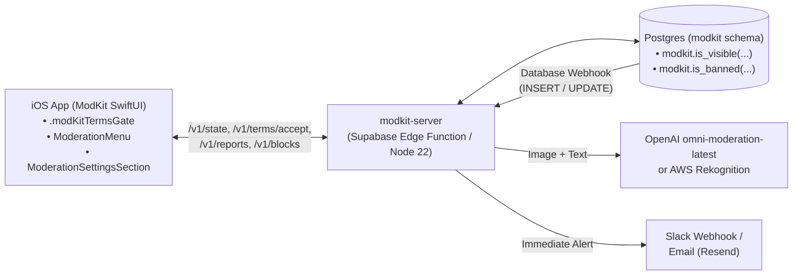

# ModKit

[](https://github.com/Liampronan/ModKit/actions/workflows/ci.yml)

**ModKit** is a self-hosted Postgres + TypeScript (`modkit-server`) + Swift 6 / SwiftUI (`ModKit`) toolkit that gives iOS apps everything required by **App Store Review Guideline 1.2 (User-Generated Content)**:

1. **Terms of Use (EULA) Gate** — `.modKitTermsGate(store:)` requires users to agree to zero-tolerance terms before viewing or contributing UGC.
2. **Automated Content Filtering** — Supabase Database Webhook processor (`/v1/webhooks/content`) runs multimodal image + text moderation via OpenAI (`omni-moderation-latest`) or AWS Rekognition (`DetectModerationLabels`).
3. **Content Reporting & 24-Hour Triage** — `ModerationMenu` lets users report content, hides the item from the reporter immediately, flags it in `modkit.items`, and alerts operators via Slack or Email (`npx modkit-server reports resolve`).
4. **Abusive User Blocking** — `ModerationMenu` and `BlockedUsersView` let users block/unblock authors, immediately removing their content locally and via Postgres RLS (`modkit.is_visible`).
5. **Published Contact & Support Links** — `ModerationSettingsSection` embeds Terms of Use, Contact & Support, and Blocked Users management directly into your app's `SettingsView`.

---

## Architecture Overview



---

## Quickstart

| Component | Directory | Guide |
| :--- | :--- | :--- |
| **iOS SDK** (`ModKit` Swift 6, iOS 18+, zero dependencies) | [`ios/`](./ios) | **[iOS SDK Guide (`ios/README.md`)](./ios/README.md)** |
| **Server, Adapters & CLI** (`modkit-server`, Node 22 / Supabase Edge Functions) | [`server/`](./server) | **[Server & CLI Guide (`server/README.md`)](./server/README.md)** |
| **Complete Specification & Adoption Guide** | [`MODERATION_SPEC.md`](./MODERATION_SPEC.md) | **[Full Spec (`MODERATION_SPEC.md`)](./MODERATION_SPEC.md)** |

### 1. Copy the Database Migration

```bash
npx modkit-server migrations copy ./supabase/migrations
```

Then call `modkit.is_visible(auth.uid()::text, user_id::text, 'your_target_type', id::text, 'post')` in your table's `SELECT` RLS policy and `NOT modkit.is_banned(auth.uid()::text)` in your `INSERT` RLS policy.

### 2. Deploy the Server Handler (`supabase/functions/modkit/index.ts`)

See [`examples/supabase/functions/modkit/index.ts`](./examples/supabase/functions/modkit/index.ts) for a drop-in Supabase Edge Function wired to `postgresStore`, `supabaseJwt`, `openAIClassifier`, `slackNotifier`, and `supabaseStorage`.

### 3. Add `ModKit` to Your iOS App

Add `https://github.com/Liampronan/ModKit` (`1.0.0-beta.1`) in Xcode or `Package.swift`:

```swift
import ModKit
import SwiftUI

// 1. Gate root UGC view on EULA acceptance
TrashMapView()
    .modKitTermsGate(store: moderationStore)

// 2. Drop ModerationMenu into any story/post view
ModerationMenu(
    targetType: "trash_pickup",
    targetId: item.id.uuidString,
    authorId: item.userId.uuidString,
    currentUserId: currentUser?.id,
    store: moderationStore,
    onHide: { dismiss() }
)

// 3. Add Blocked Users, Terms, and Contact links to Settings
ModerationSettingsSection(store: moderationStore)
```

---

## Reference & Security Docs

- **[`MODERATION_SPEC.md`](./MODERATION_SPEC.md)** — Complete Postgres schema, `/v1` wire spec, Swift API contract, and `trash-app` adoption guide.
- **[`ios/README.md`](./ios/README.md)** — Swift package integration, `ModKitClient`, `ModerationStore`, and SwiftUI views.
- **[`server/README.md`](./server/README.md)** — Server configuration, classifiers, notifiers, and `npx modkit-server` CLI reference.
- **[`PRIVACY.md`](./PRIVACY.md)** & **[`SECURITY.md`](./SECURITY.md)** — Privacy manifest details and security model.
